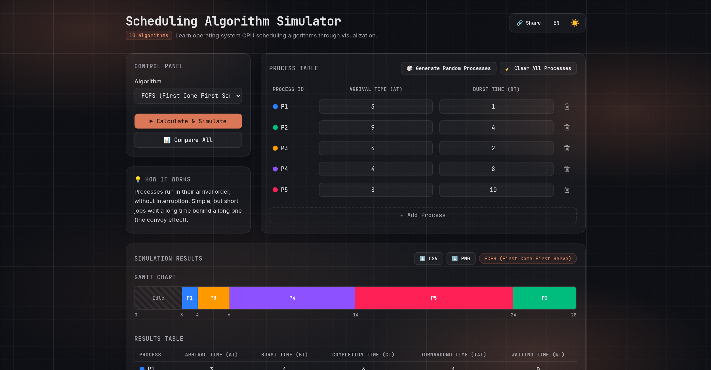
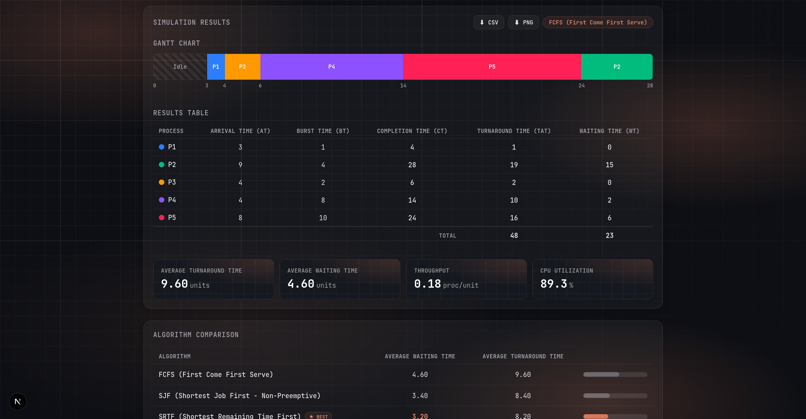

# Scheduling Algorithm Simulator

> Interactive CPU scheduling algorithm simulator with Gantt charts and algorithm comparison.

Scheduling Algorithm Simulator is an interactive educational tool for visualizing CPU scheduling in operating systems. It supports Turkish and English. Enter processes and run a scheduler to see the Gantt chart, metrics for each process, and averages. Compare all ten algorithms side by side to see which one performs best.

**[View the live application here.](https://scheduling-algorithm-batuhanmeral.vercel.app)**


## Features

- **Ten scheduling algorithms**. FCFS, SJF, SRTF, Round Robin, Priority (with and without preemption), Priority + Aging, Priority Round Robin, HRRN, and MLFQ.
- **Editable process table**. Add, delete, and edit processes, generate a random set, or clear all at once.
- **Gantt chart**. An animated timeline uses color to show CPU execution and idle periods.
- **Results table**. Completion, turnaround, and waiting time per process, plus a totals row.
- **Aggregate metrics**. Average turnaround time, average waiting time, throughput, and CPU utilization.
- **Algorithm comparison**. Run all algorithms on the same input and highlight the best by average waiting time.
- **Export**. Download results as CSV or the Gantt chart as PNG.
- **Shareable links**. The current algorithm and process set are encoded into the URL; opening a shared link restores the inputs and runs the simulation automatically.
- **Theme & language**. Light/dark mode and Turkish/English toggles, both persisted in `localStorage`.
- **Algorithm explanations**. A "How It Works" card summarizes the selected algorithm in plain language.

## Algorithms

| Algorithm | Preemptive | Notes |
| --- | --- | --- |
| **FCFS** (First Come First Serve) | No | Runs processes in arrival order. |
| **SJF** (Shortest Job First) | No | Picks the shortest available burst time next. |
| **SRTF** (Shortest Remaining Time First) | Yes | Preemptive variant of SJF; reevaluates on every arrival. |
| **RR** (Round Robin) | Yes | Cycles through processes using a configurable time quantum. |
| **Priority** | No | Runs the available process with the highest priority (lower value = higher priority). |
| **Priority (Preemptive)** | Yes | A process arriving with higher priority takes over the CPU immediately. |
| **Priority + Aging** | Yes | Waiting processes gain one effective priority level every 5 time units, preventing starvation. |
| **Priority Round Robin** | Yes | One queue per priority level; the queue with the highest priority is served with Round Robin. |
| **HRRN** (Highest Response Ratio Next) | No | Picks the highest `(waiting + burst) / burst` ratio; solves SJF's starvation problem. |
| **MLFQ** (Multilevel Feedback Queue) | Yes | Three queues: RR with quantum, RR with 2×quantum, then FCFS; jobs that exhaust their quantum are demoted. |

Each process is defined by an **arrival time (AT)**, a **burst time (BT)**, and a **priority** (used by the Priority family of algorithms). The time quantum applies to Round Robin, Priority Round Robin, and MLFQ.

## Tech Stack

- [Next.js 16.4](https://nextjs.org) (App Router) with React 19
- [Tailwind CSS 4](https://tailwindcss.com)
- TypeScript
- [Vitest](https://vitest.dev) for unit tests

## Installation

Use [Node.js](https://nodejs.org) 24 (see `.nvmrc`); CI runs on the same version.

Install dependencies and start the development server:

```bash
npm install
npm run dev
```

Open [http://localhost:3000](http://localhost:3000) in your browser.

## Development

| Command | What it does |
| --- | --- |
| `npm test` | Run all unit tests once (Vitest, suited to CI) |
| `npm test -- <file>` | Run a single test file |
| `npm run test:watch` | Run tests in watch mode |
| `npm run test:coverage` | Run tests with coverage and enforce thresholds |
| `npm run lint` | Lint with ESLint (`eslint-config-next`) |
| `npm run typecheck` | Check types with `tsc --noEmit` |
| `npm run check` | Run lint, typecheck and tests with coverage |

## CI and security

GitHub Actions runs on every pull request and on pushes to `master`:

- **CI** (`.github/workflows/ci.yml`): `test` runs lint, typecheck, unit tests with coverage thresholds and a production build; `dependency-review` blocks pull requests that add dependencies with high or critical advisories.
- **Security** (`.github/workflows/security.yml`): `scan` runs gitleaks over the full history, Semgrep (TypeScript, React, Next.js, GitHub Actions rules), zizmor and a Trivy scan of `package-lock.json`. It also runs weekly and on demand.

Actions are pinned to commit SHAs and scanner images to digests. Dependabot opens weekly grouped updates for npm packages and actions. The app sends a Content Security Policy and other security headers, defined in `next.config.ts` and covered by `next.config.test.ts`.

To report a vulnerability, see [SECURITY.md](SECURITY.md).

## Screenshots

<table>
  <tr>
    <td align="center">
      
    </td>
  </tr>
  <tr>
    <td align="center">
      
    </td>
  </tr>
</table>

## License

Released under the [MIT License](LICENSE).
